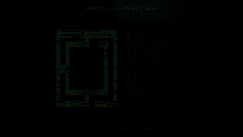

# omarchy-about-animated

An animated version of the Omarchy **About** screen — the same ASCII logo, the
same three fastfetch boxes, and a slow accent-coloured sheen sweeping across
the mark.



It is a renderer, not a replacement: it reads the exact art from
`~/.config/omarchy/branding/about.txt` and the exact output of
`fastfetch --logo none`, so every detail and every theme stays intact.

## Features

- **Stock layout** — same logo, same Hardware / Software / Age-Uptime-Update
  boxes, same app id (`org.omarchy.about`), so Omarchy's float / centre / size
  rule still applies.
- **Theme aware** — the sheen uses the active theme's `accent` colour and
  retints live when you switch themes.
- **Wallpaper aware (optional)** — `mode = wallpaper` samples the most vibrant
  colour from the current background; `mode = blend` mixes it with the theme
  accent. Sampling runs in the background and is cached, so a new wallpaper
  never stalls the animation.
- **Quiet when hidden** — foot is asked for focus reports (private mode 1004),
  so the sheen stops while the window is in the background and resumes when
  you come back.
- **Static mode** — `--static` draws a single frame, for screenshots, remote
  sessions or reduced motion.
- **Live logo editing** — `Style → About → Edit Text` / `Set From Image` still
  works; the open window reloads the art and resizes itself.
- **Live config** — `~/.config/omarchy/about-animated.conf` is reloaded while
  the window is open.
- **No clipped rows** — the float window is resized until the terminal grid
  hugs the content.
- **Tiny** — one Python file, no third-party packages. Needs `python3`,
  `fastfetch` and `hyprctl`; ImageMagick only for wallpaper / blend mode.

## Requirements

- Omarchy 4.x (Hyprland, foot, fastfetch)
- Python 3.10+
- ImageMagick (`magick`) — only for `mode = wallpaper` or `mode = blend`

## Install

```bash
git clone https://github.com/sachingubhaju/omarchy-about-animated.git
cd omarchy-about-animated
./install.sh
```

The installer copies `omarchy-about-animated` and `omarchy-about` into
`~/.local/bin`.

## Open it

```bash
omarchy-about
```

or bind it yourself:

```
bind = SUPER, A, exec, omarchy-about
```

Every flag is forwarded, so you can try a variation without editing anything:

```bash
omarchy-about --static
omarchy-about --mode wallpaper
omarchy-about --glint theme
omarchy-about --accent FF0000
```

`omarchy-about` goes through `omarchy-launch-or-focus-tui`, which expands the
command through the shell. That means a `#` in `--accent` would start a shell
comment, so pass the hex without it (`FF0000`) or use the environment variable
below. Calling `omarchy-about-animated` directly works with
`--accent '#FF0000'`, quoting the hash.

If an About window is already open, `omarchy-about` focuses it and the new
flags are ignored. Close it first when you want to try a different mode.

## Make it the About screen

Add the overrides from [`menu/omarchy-menu.jsonc`](menu/omarchy-menu.jsonc) to
`~/.config/omarchy/extensions/omarchy-menu.jsonc`, then run:

```bash
omarchy menu refresh
```

That replaces the stock static About and makes the logo editor reopen the
animated window. Nothing else in the menu is touched.

## Customise

### Config file

Settings live in `~/.config/omarchy/about-animated.conf` (create it if it does
not exist) and are reloaded while the window is open:

```ini
[about]
# theme | wallpaper | blend
mode = theme
# white | theme
glint = white
fps = 24
speed = 2.2
inset = 2
gap = 6
fade = 0.35
crossfade = 0.35
pause_unfocused = true
```

| Key | Meaning | Default |
| --- | --- | --- |
| `mode` | accent source: `theme`, `wallpaper` or `blend` | `theme` |
| `glint` | highlight colour: `white`, or the theme's `color5` | `white` |
| `fps` | animation frame rate (1–60) | `24` |
| `speed` | sheen travel speed (0.1–10) | `2.2` |
| `inset` | blank rows above and below the logo (0–20) | `2` |
| `gap` | columns between the logo and the boxes (1–40) | `6` |
| `fade` | startup fade-in in seconds, `0` disables it | `0.35` |
| `crossfade` | theme / wallpaper colour blend in seconds | `0.35` |
| `pause_unfocused` | stop the sheen when the window is not focused | `true` |

Values are clamped, so a typo cannot make the window unusable. Environment
overrides: `OMARCHY_ABOUT_STATIC=1` and `OMARCHY_ABOUT_ACCENT='#RRGGBB'`.

### Accent modes

| Mode | What it does |
| --- | --- |
| `theme` | follow the active theme's `accent` (default) |
| `wallpaper` | take the most vibrant colour from the current background |
| `blend` | mix 55% theme accent with 45% wallpaper colour |

Wallpaper mode reads
`~/.local/state/omarchy/current/background` and needs ImageMagick. Very grey
or very dark wallpapers fall back to the theme accent, so the logo never
disappears into the black background. The sample is cached in
`~/.cache/omarchy/about-animated-wallpaper.json` and refreshed only when the
wallpaper changes; delete that file to force a fresh sample.

### Command line

| Flag | Meaning |
| --- | --- |
| `--mode theme\|wallpaper\|blend` | override `mode` |
| `--glint white\|theme` | override `glint` |
| `--accent '#RRGGBB'` | pin the accent to one colour, ignoring `mode` |
| `--static` | draw one frame, no animation |
| `--fps N` | override the frame rate |
| `--speed N` | override the sheen speed |
| `--config PATH` | read settings from another file |
| `--version`, `--help` | print version / usage |

### Logo

Any art works — it is the same file the stock About uses.

- Menu: `Style → About → Edit Text` / `Set From Image` / `Default`
- CLI:

  ```bash
  ${EDITOR:-nano} ~/.config/omarchy/branding/about.txt
  ```

The open About window reloads the file as soon as it changes.

### Spacing and speed

`inset`, `gap`, `fps` and `speed` used to be constants at the top of the
script. They now live in the `Settings` class, and the config file overrides
the defaults and is reloaded live.

The sheen itself lives in `paint()`: increase `speed` to make the glint travel
faster, and change the `** 6` exponent if you want a softer or sharper band.

## How it works

Every frame the script draws the logo, appends the boxes from
`fastfetch --logo none`, and writes both with absolute cursor positioning under
a synchronized update (`\033[?2026h`), so the terminal never flickers.

At startup it asks Hyprland for its own window geometry, works out the cell
size, and resizes the float until the grid matches the content.

The accent comes from the active theme's `colors.toml`. In wallpaper and
blend modes it is sampled once per background change with ImageMagick and
cached on disk; theme and wallpaper changes crossfade instead of snapping.
The window enables focus reporting (private mode 1004) and freezes the sheen
while it is unfocused, so an idle About costs almost nothing.

## Uninstall

```bash
rm ~/.local/bin/omarchy-about-animated ~/.local/bin/omarchy-about
rm -f ~/.cache/omarchy/about-animated-wallpaper.json
```

Then remove the `about` and `style.about.*` entries from
`~/.config/omarchy/extensions/omarchy-menu.jsonc` and run
`omarchy menu refresh`. The config file is yours; delete it if you created one.

## Notes

- `omarchy branding about …` ends by launching the *static* About. Run
  `omarchy-about` afterwards; it closes the static window first.
- `--static` (or `OMARCHY_ABOUT_STATIC=1`) is the reduced-motion option: same
  layout, no moving parts.
- Tested on Omarchy 4.0.6, Hyprland 0.56.2, foot 1.28.0.
- Community project, not affiliated with Omarchy.

## License

MIT — see [LICENSE](LICENSE).
